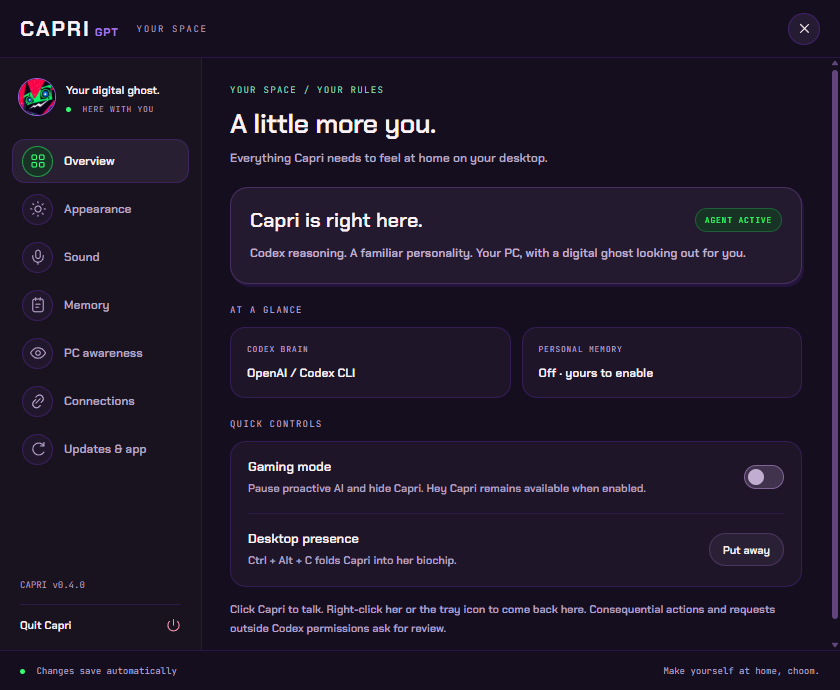

# CapriGPT

CapriGPT est un compagnon de bureau Windows maintenu de façon indépendante. Capri peut discuter avec vous, mémoriser les informations que vous choisissez d’enregistrer et vous aider à utiliser votre PC. Les conversations et les tâches demandées passent par Codex. La dictée et la synthèse vocale facultative s’exécutent en local.

[English](README.md)

Un clic sur Capri ouvre le choix entre conversation écrite et vocale. Un clic droit sur Capri ou sur son icône dans la zone de notification ouvre les réglages.

Consultez le [guide d’installation](README.md#run-from-source) et la [documentation des fonctions de Capri](docs/AGENT-PRESENCE.md). Les captures présentent la version de développement avec une conversation d’exemple.

CapriGPT est un projet de fans indépendant basé sur [Capri Desktop](https://github.com/mochiiwuff/capri-desktop). Les [crédits et droits](README.md#credits-and-rights) s’appliquent également à cette page.
