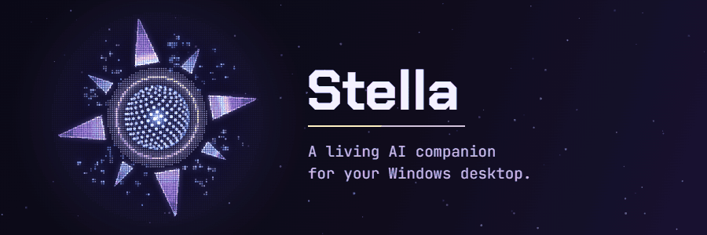
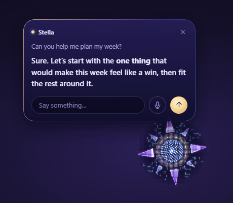
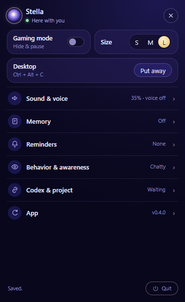
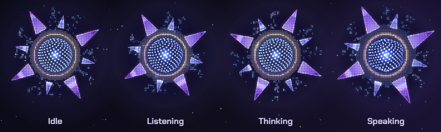

<div align="center">



<h3>Une compagne IA vivante pour votre bureau Windows.</h3>

<p>Elle flotte à côté de votre travail, discute avec vous, retient ce que vous choisissez<br>et vous aide sur votre PC quand vous le demandez.</p>

[](https://github.com/AnalogicGoose/Stella/actions/workflows/ci.yml)
[](LICENSE)


[Démarrage rapide](#démarrage-rapide) · [Ce qu’elle sait faire](#ce-quelle-sait-faire) · [Confidentialité](#confidentialité-et-contrôle) · [English](README.md)

</div>

---

## Voici Stella

La plupart des assistants vivent dans un onglet de navigateur et attendent. Stella vit **sur votre bureau**. C’est un petit personnage original, un globe de lumière translucide dans un anneau doré et rosé, entouré de lames violettes qui tournent. On voit toujours ce qu’elle fait : elle se resserre pour écouter, accélère pour réfléchir et ondule avec sa voix quand elle parle.

Cliquez sur elle pour discuter par écrit ou à voix haute, ou dites simplement **« Hey Stella »**. Les conversations et les tâches demandées passent par [Codex](https://github.com/openai/codex). La dictée s’exécute en local sur votre PC.

<table>
<tr>
<td width="55%" valign="top"></td>
<td width="45%" valign="top"></td>
</tr>
</table>

## Ce qu’elle sait faire

- **Parler et écouter :** discussion écrite ou vocale, mot d’éveil « Hey Stella », voix expressive facultative.
- **Aider sur votre PC :** sur demande, elle ouvre des applications et des sites, cherche sur le web, lit une capture d’écran, utilise les contrôles du bureau et travaille dans un projet choisi.
- **Se souvenir, si vous le voulez :** objectifs, décisions, points de reprise et routines réutilisables. La mémoire est désactivée par défaut.
- **Rappels :** elle vient vous voir au bon moment.
- **Rester discrète :** le mode jeu, les applications en plein écran et <kbd>Ctrl</kbd>+<kbd>Alt</kbd>+<kbd>C</kbd> la replient en un point de lumière.



## Démarrage rapide

Il faut **Windows x64**, **Git**, **Node.js 24** et le **[Codex CLI](https://github.com/openai/codex)** connecté.

```powershell
git clone https://github.com/AnalogicGoose/Stella.git
cd Stella
npm.cmd ci
npm.cmd start
```

Cliquez sur Stella pour discuter. Un clic droit sur elle ou sur son icône dans la zone de notification ouvre le **salon de contrôle**.

## Confidentialité et contrôle

- **Le micro reste local :** la dictée s’exécute sur votre PC.
- **La mémoire est facultative :** elle est désactivée au départ, et vous pouvez tout consulter, exporter ou effacer.
- **Elle demande d’abord :** les actions importantes attendent votre accord.

## Crédits et licence

Stella est partie de [Capri Desktop](https://github.com/mochiiwuff/capri-desktop) de mochiiwuff et ses contributeurs. Stella est un personnage original créé pour ce projet. Le code est sous [licence MIT](LICENSE).
