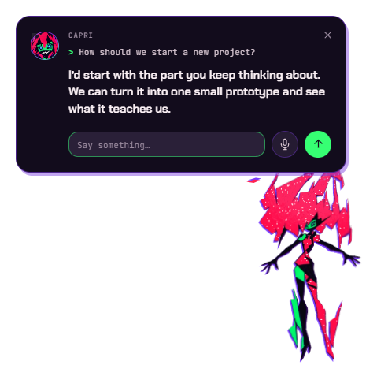
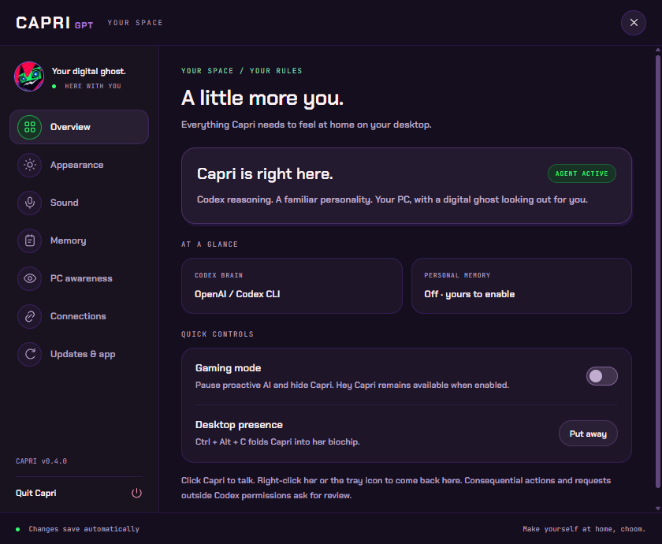

# Stella

Stella is an independently maintained Windows desktop companion. Stella can talk with you, remember information you choose to save, and help with tasks on your PC. She uses Codex for conversation and requested work, with local microphone transcription and optional local speech.

[Français](README.fr.md)



## What Stella can do

- **Talk and listen.** Click Stella to start a text or voice conversation. [Wake word](docs/WAKE-WORD.md) · [Expressive speech](docs/EXPRESSIVE-VOICE.md)
- **Start a conversation.** She can bring back an interest she chose or revisit a question when she has fresh evidence. [Agent presence](docs/AGENT-PRESENCE.md) · [Chosen interests](docs/COMPANION-INTERESTS.md)
- **Help with desktop tasks.** On request, she can inspect a screen snapshot, use desktop controls, and work in a selected project. [Desktop tools](docs/AGENT-PRESENCE.md) · [Project companion](docs/PROJECT-COMPANION.md)
- **Pick up where you left off.** Save goals, decisions, and resume points, or teach Stella a routine she can run when requested. [Continuity](docs/COMPANION-CONTINUITY.md) · [Reusable routines](docs/REUSABLE-ROUTINES.md)

## Run from source

Use Windows x64, Git, Node.js 24, and a signed-in Codex CLI.

```powershell
git clone https://github.com/AnalogicGoose/Stella.git
cd Stella
npm.cmd ci
npm.cmd start
```

Right-click Stella or her tray icon to open the **Control room**. If Stella cannot find the Codex CLI, select its executable under **Connections**. [Development and build instructions](CONTRIBUTING.md)



Screenshots show the development app with a sample conversation.

## Credits and rights

Stella builds on [Capri Desktop](https://github.com/mochiiwuff/capri-desktop) by mochiiwuff and its contributors. The original project’s documentation and screenshots are available there.

Stella is an original character made for this project. The [MIT license](LICENSE) covers the code.

Fonts are Chakra Petch and JetBrains Mono, distributed via Fontsource under the SIL Open Font License.
